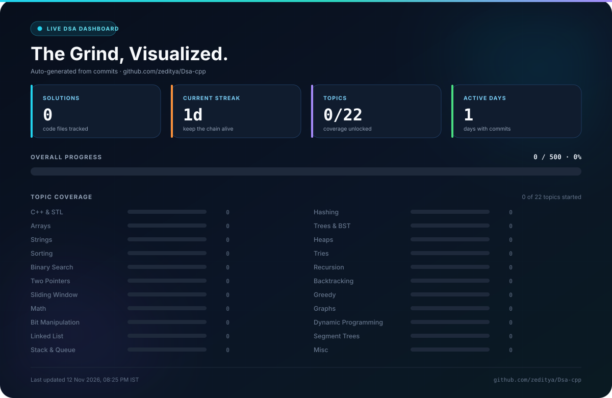
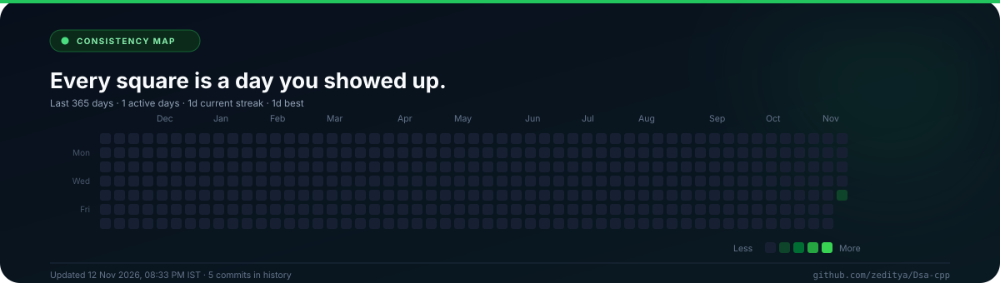

<!--
  ⚡ AUTO-GENERATED README — do not edit this file directly.
  ✏️  Edit scripts/readme_template.md, then push. GitHub Actions rebuilds it.
  🎨  Dashboard + heatmap are generated by scripts/update_readme.py.
-->

<div align="center">

<a href="https://github.com/zeditya/Dsa-cpp">
  
</a>

<a href="https://git.io/typing-svg">
  
</a>

<br/>


<br/><br/>

[](#-the-dashboard)
[](#-tech-stack)
[](#-how-this-readme-stays-alive)
[](#)

</div>

---

## 👋 Hey, I'm Aditya

> **"Consistency compounds. Solve one problem today, become undeniably better tomorrow."**

I'm on a mission to master **Data Structures & Algorithms in C++** before I graduate — and keep going long after.

This repository is my **public proof of work**: every solution, every note, every late-night bug fix. It's not a code dump; it's a **living record** of the grind. The README you're reading is generated from the repo itself, so it always reflects exactly where I am.

**Currently sharpening:** the fundamentals — first solution loading…

<br/>

| 🎯 The Mission | 🧱 How It's Built | 🤖 Always Fresh |
| :--- | :--- | :--- |
| Master DSA fundamentals, then go deep into advanced patterns. | Topic-first folders, metadata-rich solution files, and zero friction. | A GitHub Action rebuilds this README on every push and daily at 00:15 IST. |

---

## 📊 The Dashboard

<div align="center">

  
  
  
  
  

<br/><br/>

<a href="https://github.com/zeditya/Dsa-cpp">
  
</a>

</div>

<sub>▲ Auto-generated from the files and commit history in this repository. Last rebuilt: **12 Nov 2026, 08:25 PM IST**.</sub>

---

## 🧭 Topic Coverage

Each topic has a soft goal of **25 solutions**. Progress bars are relative to that goal — the goal is a direction, not a ceiling.

| Topic | Solved / Goal | Progress |
| :--- | :---: | :--- |
| ⚙️ **C++ & STL** | `  0 / 25` | `░░░░░░░░░░░░░░░░` **0%** |
| 🧮 **Arrays** | `  0 / 25` | `░░░░░░░░░░░░░░░░` **0%** |
| 🔤 **Strings** | `  0 / 25` | `░░░░░░░░░░░░░░░░` **0%** |
| 🔀 **Sorting** | `  0 / 25` | `░░░░░░░░░░░░░░░░` **0%** |
| 🎯 **Binary Search** | `  0 / 25` | `░░░░░░░░░░░░░░░░` **0%** |
| 👉 **Two Pointers** | `  0 / 25` | `░░░░░░░░░░░░░░░░` **0%** |
| 🪟 **Sliding Window** | `  0 / 25` | `░░░░░░░░░░░░░░░░` **0%** |
| ➗ **Math** | `  0 / 25` | `░░░░░░░░░░░░░░░░` **0%** |
| 🔢 **Bit Manipulation** | `  0 / 25` | `░░░░░░░░░░░░░░░░` **0%** |
| 🔗 **Linked List** | `  0 / 25` | `░░░░░░░░░░░░░░░░` **0%** |
| 🥞 **Stack & Queue** | `  0 / 25` | `░░░░░░░░░░░░░░░░` **0%** |
| 🗃️ **Hashing** | `  0 / 25` | `░░░░░░░░░░░░░░░░` **0%** |
| 🌳 **Trees & BST** | `  0 / 25` | `░░░░░░░░░░░░░░░░` **0%** |
| ⛰️ **Heaps** | `  0 / 25` | `░░░░░░░░░░░░░░░░` **0%** |
| 🌲 **Tries** | `  0 / 25` | `░░░░░░░░░░░░░░░░` **0%** |
| 🌀 **Recursion** | `  0 / 25` | `░░░░░░░░░░░░░░░░` **0%** |
| 🧩 **Backtracking** | `  0 / 25` | `░░░░░░░░░░░░░░░░` **0%** |
| 💡 **Greedy** | `  0 / 25` | `░░░░░░░░░░░░░░░░` **0%** |
| 🕸️ **Graphs** | `  0 / 25` | `░░░░░░░░░░░░░░░░` **0%** |
| 🧠 **Dynamic Programming** | `  0 / 25` | `░░░░░░░░░░░░░░░░` **0%** |
| 📊 **Segment Trees** | `  0 / 25` | `░░░░░░░░░░░░░░░░` **0%** |
| 📦 **Misc** | `  0 / 25` | `░░░░░░░░░░░░░░░░` **0%** |

> **Next milestone:** **50 solutions** · **Overall:** 0 / 500 solutions (0%)

---

## 🕘 Recently Solved

> 🚀 **No solutions tracked yet.** Add your first file under `DSA/Arrays/` and this table will populate itself on the next push.

---

## 🔥 Consistency Map

<div align="center">
  
</div>

<sub>▲ Every square is a day this repository moved forward. Generated from git history, not a third-party service.</sub>

---

## 🗺️ The Roadmap

The roadmap checks itself as soon as a topic gets its first solution.

### Phase 1 · Foundations
`0 / 9 topics started`

- [ ] ⚙️ **C++ & STL**
- [ ] 🧮 **Arrays**
- [ ] 🔤 **Strings**
- [ ] 🔀 **Sorting**
- [ ] 🎯 **Binary Search**
- [ ] 👉 **Two Pointers**
- [ ] 🪟 **Sliding Window**
- [ ] ➗ **Math**
- [ ] 🔢 **Bit Manipulation**

### Phase 2 · Core Data Structures
`0 / 6 topics started`

- [ ] 🔗 **Linked List**
- [ ] 🥞 **Stack & Queue**
- [ ] 🗃️ **Hashing**
- [ ] 🌳 **Trees & BST**
- [ ] ⛰️ **Heaps**
- [ ] 🌲 **Tries**

### Phase 3 · Algorithms
`0 / 5 topics started`

- [ ] 🌀 **Recursion**
- [ ] 🧩 **Backtracking**
- [ ] 💡 **Greedy**
- [ ] 🕸️ **Graphs**
- [ ] 🧠 **Dynamic Programming**

### Phase 4 · Advanced
`0 / 2 topics started`

- [ ] 📊 **Segment Trees**
- [ ] 📦 **Misc**

---

## 📈 GitHub Stats

<div align="center">


<br/>


</div>


---

## 🏆 Trophy Case

<div align="center">
  
</div>

---

## 🐍 The Contribution Snake

<div align="center">
  <picture>
    <source media="(prefers-color-scheme: dark)" srcset="https://raw.githubusercontent.com/zeditya/Dsa-cpp/output/github-contribution-grid-snake-dark.svg" />
    <source media="(prefers-color-scheme: light)" srcset="https://raw.githubusercontent.com/zeditya/Dsa-cpp/output/github-contribution-grid-snake.svg" />
    
  </picture>
</div>

<sub>▲ Generated every day by the `Generate Snake` workflow and published to the `output` branch. The first snake appears after the next workflow run.</sub>

---

## 🛠️ Tech Stack

<div align="center">
  
</div>

---

## 🤖 How This README Stays Alive

This is a **zero-maintenance README**. It updates itself:

1. **On every push** to `main` (and daily at **00:15 IST**), GitHub Actions runs `scripts/update_readme.py`.
2. The script scans every solution file and reads its metadata header (`Problem`, `Topic`, `Difficulty`, `Link`, `Time`, `Space`).
3. It recomputes totals, per-topic progress, streaks, active days, and the recent-solutions table.
4. It regenerates `assets/dashboard.svg`, `assets/activity.svg`, and this `README.md`.
5. The action commits the result with `[skip ci]`, so the loop stops there.

**No servers. No manual updates. Set it. Forget it.**

<details>
<summary><b>⚙️ Want to customize it?</b></summary>

<br/>

| What | Where |
| :--- | :--- |
| Name, repo, targets, timezone | `scripts/config.json` |
| README design and copy | `scripts/readme_template.md` |
| Automation schedule | `.github/workflows/update-readme.yml` |
| Snake animation | `.github/workflows/snake.yml` |
| Run it locally | `python3 scripts/update_readme.py` |
| Trigger manually | **Actions → Update README → Run workflow** |

</details>

---

## ➕ Add a Solution

Drop a file anywhere — the **folder path decides the topic** (`DSA/Graphs/...` → Graphs). For the richest stats, start every file with this header:

```cpp
/*
 * Problem   : 0001. Two Sum
 * Topic     : Arrays
 * Difficulty: Easy        // Easy | Medium | Hard
 * Link      : https://leetcode.com/problems/two-sum/
 * Time      : O(n)
 * Space     : O(n)
 *
 * Approach:
 *   Store each number's complement in a hash map while scanning.
 */
#include <bits/stdc++.h>
using namespace std;
```

A ready-to-copy version lives in [`templates/solution.cpp`](templates/solution.cpp).

**Recommended layout:**

```text
Dsa-cpp/
├── DSA/
│   ├── Arrays/
│   ├── Strings/
│   ├── LinkedList/
│   ├── StackQueue/
│   ├── Trees/
│   ├── Graphs/
│   ├── DynamicProgramming/
│   └── ...
├── CPP/
│   ├── Basics/
│   ├── OOP/
│   └── STL/
├── templates/
├── scripts/
└── assets/
```

Naming tips: `0001-two-sum.cpp`, `lru-cache.cpp`, or `binary-search.cpp`. Numbers sort nicely; the script handles both.

---

## 🌱 The Long Game

I have **two years until graduation** — and the plan doesn't stop there.

- **Year 1:** Build unbreakable fundamentals. Solve broadly. Write clean, explainable code.
- **Year 2:** Go deep on patterns, optimization, and contest-level problem solving.
- **Beyond:** Keep the streak alive. Mentor, contribute, and never stop learning.

> *"The expert in anything was once a beginner who refused to quit."*

---

<div align="center">

### ⭐ If this repository helps you, drop a star — it fuels the grind.

<a href="https://github.com/zeditya/Dsa-cpp/stargazers">
  
</a>

<br/><br/>


<sub>Built with C++, curiosity, and a GitHub Action that never sleeps.</sub>

</div>
