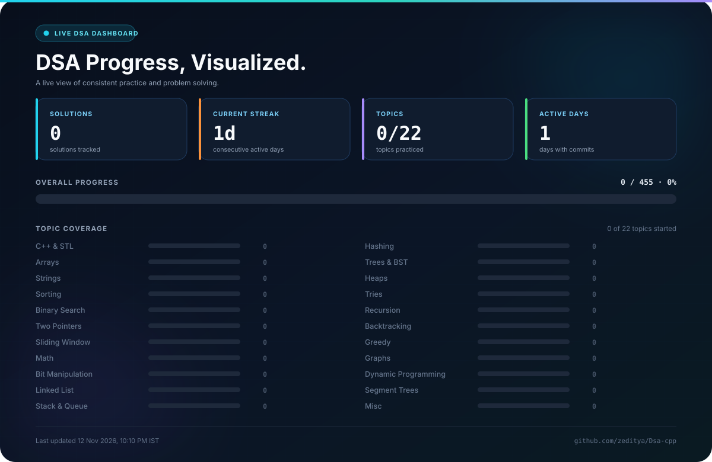
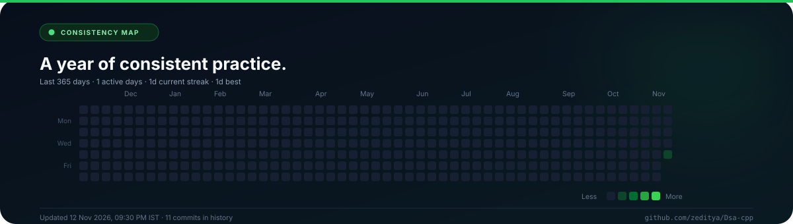

<!--
  AUTO-GENERATED README. Do not edit this file directly.
  Source: maintenance/scripts/readme_template.md
  Generator: maintenance/scripts/update_readme.py
-->

 

## Hi, I'm Aditya

I'm a computer science student building a strong foundation in data structures, algorithms, and modern C++. This repository is my public practice log, where I solve problems consistently and focus on writing code I can explain.

I care about clean implementation, clear reasoning, and steady progress.

**Current focus:** DSA fundamentals

## Progress at a Glance

  
  
  
  

  

Updated automatically from the repository on 12 Nov 2026, 08:47 PM IST.

## What You'll Find Here

- **DSA solutions** organized by topic, from arrays and strings to graphs and dynamic programming.
- **Clean C++** covering STL, object-oriented programming, and modern language features.
- **Problem analysis** with time and space complexity notes plus the approach behind each solution.
- **Consistent practice** tracked automatically from the repository's commit history.

## Recent Work

> The first solutions are on the way. This section updates automatically as new problems are completed.

## Consistency

  

## GitHub Activity

## Contribution Activity

  <picture>
    <source media="(prefers-color-scheme: dark)" srcset="https://raw.githubusercontent.com/zeditya/Dsa-cpp/output/github-contribution-grid-snake-dark.svg" />
    <source media="(prefers-color-scheme: light)" srcset="https://raw.githubusercontent.com/zeditya/Dsa-cpp/output/github-contribution-grid-snake.svg" />
    
  </picture>

## Tech Stack

  

## Let's Connect

I'm always open to feedback, collaboration, and interesting problems.

  

---

This README updates automatically. <a href="maintenance/MANUAL.md">Repository manual</a>

