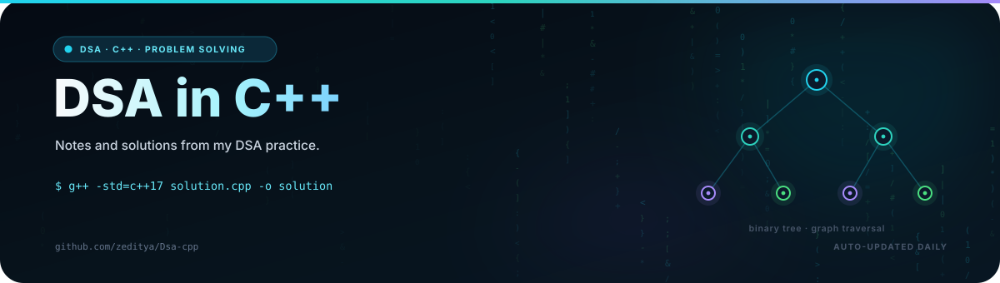
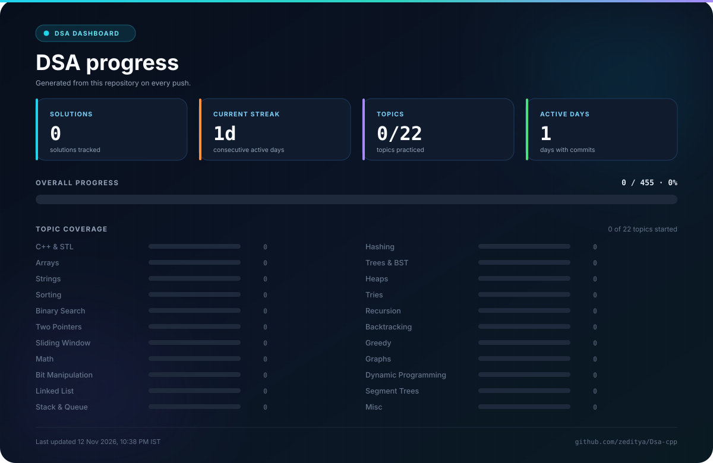
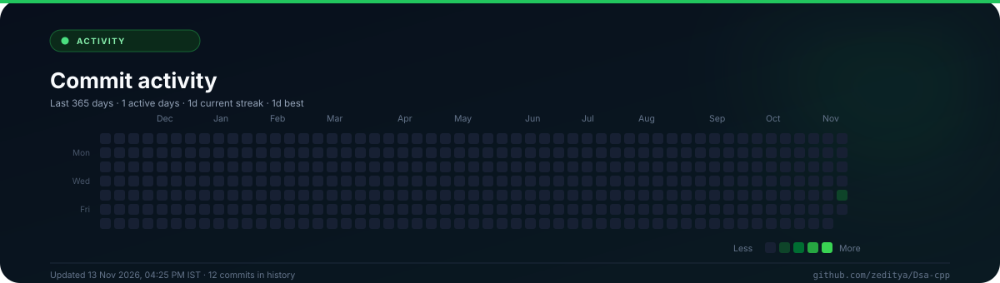

<!--
  AUTO-GENERATED README. Do not edit this file directly.
  Source: .github/readme/scripts/readme_template.md
  Generator: .github/readme/scripts/update_readme.py
-->

<div align="center">

<a href="https://github.com/zeditya/Dsa-cpp">
  
</a>

<br/>


<br/>

**[What this is](#what-this-is) • [Progress](#progress) • [How I practice](#how-i-practice) • [Activity](#activity) • [Repo](#repo) • [Connect](#connect)**

</div>

---

## What this is

This is where I practice data structures and algorithms in C++. Each solution lives here with a short note on the pattern, the approach, and the time and space complexity.

I'm working through [Striver's A2Z sheet](https://takeuforward.org/strivers-a2z-dsa-course/strivers-a2z-dsa-course-sheet-2/), but I'm not trying to finish it as fast as possible. I'd rather understand a problem properly, come back to it after a few days, and be able to solve something similar on my own.

The goal is simple: get good enough at the basics that new problems stop looking unfamiliar.

---

## Progress

| 🧩 Solved | 🟢 Easy | 🟡 Medium | 🔴 Hard | 🔥 Streak | 🏆 Best | 📅 Active |
|:---:|:---:|:---:|:---:|:---:|:---:|:---:|
| **0** / 455 | 0 | 0 | 0 | 1 day | 1 day | 1 |

<div align="center">
  
</div>

<sub>Updated 13 Nov 2026, 04:25 PM IST.</sub>

### The big picture

`░░░░░░░░░░░░░░░░░░░░░░░░` **0% of the A2Z sheet**

**0 / 455** problems logged · **455** to go

| Difficulty | Solved | Mix |
|:---|:---:|:---|
| 🟢 Easy | 0 | `░░░░░░░░░░░░░░` 0% |
| 🟡 Medium | 0 | `░░░░░░░░░░░░░░` 0% |
| 🔴 Hard | 0 | `░░░░░░░░░░░░░░` 0% |

| This week | Last 7 days | Last 30 days | Avg / week | Projected finish |
|:---:|:---:|:---:|:---:|:---:|
| 0 | 0 | 0 | — | — |

<sub>Pace is measured from my first commit. Projected finish assumes the current average holds.</sub>

> **Next up:** Step 1 · **Learn the Basics** — 0 / 34 solved, 34 to go.

### Striver's A2Z tracker

Status: ⬜ Not started • 🟨 In progress • 🟩 Target reached

| # | Step | Solved | Progress | Status |
|:-:|:---|:---:|:---|:---:|
| 1 | Learn the Basics | 0 / 34 | `░░░░░░░░░░░░` 0% | ⬜ |
| 2 | Sorting Techniques | 0 / 7 | `░░░░░░░░░░░░` 0% | ⬜ |
| 3 | Arrays | 0 / 46 | `░░░░░░░░░░░░` 0% | ⬜ |
| 4 | Binary Search | 0 / 34 | `░░░░░░░░░░░░` 0% | ⬜ |
| 5 | Strings | 0 / 15 | `░░░░░░░░░░░░` 0% | ⬜ |
| 6 | Linked List | 0 / 32 | `░░░░░░░░░░░░` 0% | ⬜ |
| 7 | Recursion | 0 / 27 | `░░░░░░░░░░░░` 0% | ⬜ |
| 8 | Bit Manipulation | 0 / 10 | `░░░░░░░░░░░░` 0% | ⬜ |
| 9 | Stack and Queues | 0 / 31 | `░░░░░░░░░░░░` 0% | ⬜ |
| 10 | Sliding Window and Two Pointers | 0 / 12 | `░░░░░░░░░░░░` 0% | ⬜ |
| 11 | Heaps | 0 / 8 | `░░░░░░░░░░░░` 0% | ⬜ |
| 12 | Greedy Algorithms | 0 / 15 | `░░░░░░░░░░░░` 0% | ⬜ |
| 13 | Binary Trees | 0 / 40 | `░░░░░░░░░░░░` 0% | ⬜ |
| 14 | Binary Search Trees | 0 / 16 | `░░░░░░░░░░░░` 0% | ⬜ |
| 15 | Graphs | 0 / 52 | `░░░░░░░░░░░░` 0% | ⬜ |
| 16 | Dynamic Programming | 0 / 60 | `░░░░░░░░░░░░` 0% | ⬜ |
| 17 | Tries | 0 / 7 | `░░░░░░░░░░░░` 0% | ⬜ |
| 18 | Strings (Advanced) | 0 / 9 | `░░░░░░░░░░░░` 0% | ⬜ |
| | **Overall** | **0 / 455** | `░░░░░░░░░░░░` **0%** | |

> Solved counts come from the folders and metadata in this repo. A few topics map to
> more than one step, so individual rows can overlap. The **Overall** row is the
> source of truth for sheet progress.

<details>
<summary><strong>Milestones</strong></summary>

### Problems solved · 0/7 reached
- [ ] 10 problems
- [ ] 50 problems
- [ ] 100 problems
- [ ] 250 problems
- [ ] 455 problems • A2Z sheet complete
- [ ] 600 problems
- [ ] 800 problems

### Streaks · 0/6 reached
- [ ] 7-day streak
- [ ] 30-day streak
- [ ] 50-day streak
- [ ] 100-day streak
- [ ] 200-day streak
- [ ] 365-day streak

### Skills · 0/7 reached
- [ ] C++ & STL started
- [ ] 10 Easy problems solved
- [ ] 25 Medium problems solved
- [ ] Graphs started
- [ ] Dynamic Programming started
- [ ] All 22 topics started
- [ ] First contest logged

</details>

---

## How I practice

1. Try the problem for 20-30 minutes without help.
2. If I'm stuck, read only enough to understand the idea, then close the solution.
3. Rewrite it from memory.
4. Write down the pattern and the mistake I made.
5. Solve it again after 3 days, and once more after 2-3 weeks.

I only commit code I can explain. If I can't explain it, I haven't learned it yet.

---

## Activity

### Recent work

No solutions logged yet.

### Weekly log

| Week | Topics | Solved | Commits |
|:---|:---|:---:|:---:|
| 09 Nov - 13 Nov (current) | - | 0 | 12 |

> The log is generated from my commits. Empty weeks are hidden and the current week is partial.

### Heatmap

<div align="center">
  
</div>

<div align="center">
  <picture>
    <source media="(prefers-color-scheme: dark)" srcset="https://raw.githubusercontent.com/zeditya/Dsa-cpp/output/github-contribution-grid-snake-dark.svg" />
    <source media="(prefers-color-scheme: light)" srcset="https://raw.githubusercontent.com/zeditya/Dsa-cpp/output/github-contribution-grid-snake.svg" />
    
  </picture>
</div>

> Heatmap for the last 365 days. The snake is generated from the same contributions.

---

## Repo

```text
Dsa-cpp/
├── CPP/                            0 solutions
├── DSA/                            0 solutions
└── README.md                       auto-generated profile
```

Each solution starts with a short header:

```cpp
/*
 * Problem   : <number>. <name>
 * Topic     : <e.g. Arrays>
 * Difficulty: <Easy | Medium | Hard>
 * Pattern   : <e.g. hash map, sliding window>
 * Link      : <url>
 * Time      : O(?)    Space : O(?)
 *
 * Approach:
 *   <1-2 lines in my own words>
 */
```

Run a file with:

```bash
g++ -std=c++17 -O2 -Wall solution.cpp -o solution && ./solution
```

**Toolbox:** `C++17` • `STL` • `Git` • `GitHub Actions` • `VS Code` • `Linux`

---

## Connect

I'm open to internships, collaborations, and conversations about problem solving. If you're working through the same sheet, I'd be glad to compare notes.

<div align="center">

[**GitHub**](https://github.com/zeditya) · [**Email**](mailto:adityabahuguna098@gmail.com) · [**Open an issue**](https://github.com/zeditya/Dsa-cpp/issues/new) · [**Star this repo**](https://github.com/zeditya/Dsa-cpp/stargazers)

</div>

**Currently:** working through Striver's A2Z sheet · 🎯 455 problems to go · 🔥 1-day streak

| 🤝 Open to | 💬 Ask me about |
|:---|:---|
| • Internships<br/>• Open-source collaborations<br/>• DSA study groups<br/>• Code reviews | • C++ and the STL<br/>• Problem-solving patterns<br/>• Striver's A2Z sheet<br/>• Writing code I can explain |

<sub>📍 India · IST · ⏱️ Usually replies within a couple of days.</sub>

<sub>If this repo helps you, a ⭐ is the easiest way to say thanks.</sub>


<div align="center">

<sub>README, dashboard, and logs are generated from this repository on every push.</sub>

</div>
