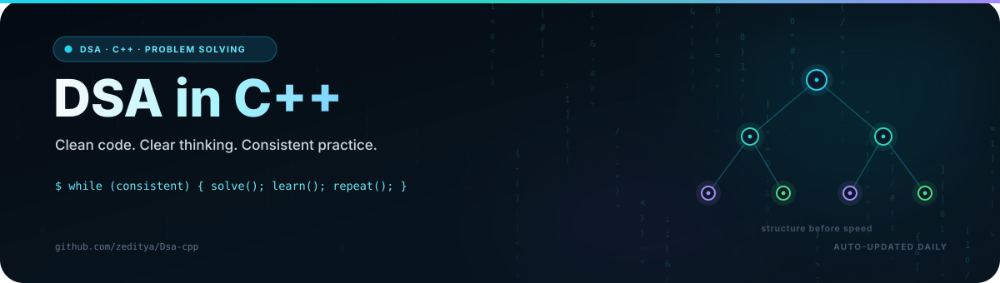
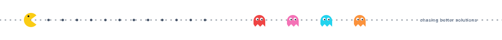

<!--
  AUTO-GENERATED README. Do not edit this file directly.
  Source: maintenance/scripts/readme_template.md
  Generator: maintenance/scripts/update_readme.py
-->

<div align="center">

<a href="https://github.com/zeditya/Dsa-cpp">
  
</a>

<br/>


<br/>

**Consistency over intensity. Every day. Until graduation and beyond.**

**[The Goal](#-the-goal) • [Tracker](#-progress-tracker) • [Milestones](#-milestones) • [Method](#-my-method) • [Weekly Log](#-weekly-log) • [Resources](#-resources)**

</div>

---

## 🎯 The Goal

> Become an elite problem solver. Solve problems daily, learn every pattern deeply, and build a record that speaks for itself, **until graduation and beyond**.

| | |
| :--- | :--- |
| 🗓️ **Started** | `12 Nov 2026` |
| 🧠 **Language** | C++17 |
| 📚 **Main Sheet** | [Striver's A2Z DSA Sheet](https://takeuforward.org/strivers-a2z-dsa-course/strivers-a2z-dsa-course-sheet-2/) |
| 🔥 **Daily Target** | 1-2 problems |
| 🏁 **Long-Term Target** | 600-800+ problems |
| 🎯 **Current Focus** | DSA fundamentals |

`Next milestone` **10 problems** (First steps)

---

## 📊 Progress Tracker

### Overall

```text
Total solved:  0 / 455
[░░░░░░░░░░░░░░░░░░░░]  0%
```

> The bar is generated from the current repository. Every new solution moves it.

### Stats at a glance

| 🧩 Total Solved | 🟢 Easy | 🟡 Medium | 🔴 Hard | 🔥 Current Streak | 🏆 Best Streak |
|:---:|:---:|:---:|:---:|:---:|:---:|
| **0** | 0 | 0 | 0 | 1 day | 1 day |

<div align="center">
  
</div>

<sub>Auto-updated on 12 Nov 2026, 10:10 PM IST.</sub>

### Striver's A2Z: Step by Step

Status key: ⬜ Not started • 🟨 In progress • 🟩 All mapped topics started

| # | Step | Status | Solved | Coverage |
|:-:|:---|:---:|:---:|:---|
| 1 | Learn the Basics | ⬜ | 0 | `░░░░░░░░░░░░░░░░` 0% |
| 2 | Sorting Techniques | ⬜ | 0 | `░░░░░░░░░░░░░░░░` 0% |
| 3 | Arrays | ⬜ | 0 | `░░░░░░░░░░░░░░░░` 0% |
| 4 | Binary Search | ⬜ | 0 | `░░░░░░░░░░░░░░░░` 0% |
| 5 | Strings | ⬜ | 0 | `░░░░░░░░░░░░░░░░` 0% |
| 6 | Linked List | ⬜ | 0 | `░░░░░░░░░░░░░░░░` 0% |
| 7 | Recursion | ⬜ | 0 | `░░░░░░░░░░░░░░░░` 0% |
| 8 | Bit Manipulation | ⬜ | 0 | `░░░░░░░░░░░░░░░░` 0% |
| 9 | Stack and Queues | ⬜ | 0 | `░░░░░░░░░░░░░░░░` 0% |
| 10 | Sliding Window and Two Pointers | ⬜ | 0 | `░░░░░░░░░░░░░░░░` 0% |
| 11 | Heaps | ⬜ | 0 | `░░░░░░░░░░░░░░░░` 0% |
| 12 | Greedy Algorithms | ⬜ | 0 | `░░░░░░░░░░░░░░░░` 0% |
| 13 | Binary Trees | ⬜ | 0 | `░░░░░░░░░░░░░░░░` 0% |
| 14 | Binary Search Trees | ⬜ | 0 | `░░░░░░░░░░░░░░░░` 0% |
| 15 | Graphs | ⬜ | 0 | `░░░░░░░░░░░░░░░░` 0% |
| 16 | Dynamic Programming | ⬜ | 0 | `░░░░░░░░░░░░░░░░` 0% |
| 17 | Tries | ⬜ | 0 | `░░░░░░░░░░░░░░░░` 0% |
| 18 | Strings (Advanced) | ⬜ | 0 | `░░░░░░░░░░░░░░░░` 0% |

> Coverage tracks topics started, not every problem in the sheet. It updates from the folders and metadata in this repository.

---

## 🏅 Milestones

### Problems solved
- [ ] 10 • First steps
- [ ] 50 • Building momentum
- [ ] 100 • Triple digits
- [ ] 250 • Serious grinder
- [ ] 455 • A2Z sheet complete
- [ ] 600 • Beyond the sheet
- [ ] 800 • Elite territory

### Consistency
- [ ] 7-day streak
- [ ] 30-day streak
- [ ] 50-day streak
- [ ] 100-day streak
- [ ] 200-day streak
- [ ] 365-day streak

### Skills
- [ ] C++ & STL started
- [ ] 10 Easy problems solved
- [ ] 25 Medium problems solved
- [ ] Graphs started
- [ ] Dynamic Programming started
- [ ] All 22 topics started
- [ ] First contest logged

> Every checkbox is recalculated from the repository. Nothing is updated by hand.

---

## 🧠 My Method

Every problem goes through the same loop:

```text
┌─────────────────────────────────────────────────────────┐
│  1. THINK    20-30 min on paper, no help                │
│  2. HINT     only the technique name, then retry        │
│  3. LEARN    read/watch solution, then CLOSE IT         │
│  4. CODE     rewrite from scratch, from memory          │
│  5. NOTE     pattern + mistake, then save the note      │
│  6. REVISE   re-solve after 3 days, then after 2-3 wks  │
└─────────────────────────────────────────────────────────┘
```

**Rules I follow**

- Only push code I fully understand and can explain out loud
- Never skip the revision step
- Track topics mastered, not just days
- Rest one day a week. Burnout is the real enemy
- Exam weeks: minimum 1 problem, no guilt

---

## 🚀 Recent Work

> **Day one.** The first solution is the hardest. Add a file under `DSA/` and this table will update on the next push.

---

## 🗓️ Weekly Log

| Week | Topics | Solved | Commits |
|:---|:---|:---:|:---:|
| 09 Nov - 12 Nov (current) | - | 0 | 6 |
| 02 Nov - 08 Nov | - | 0 | 0 |
| 26 Oct - 01 Nov | - | 0 | 0 |
| 19 Oct - 25 Oct | - | 0 | 0 |
| 12 Oct - 18 Oct | - | 0 | 0 |
| 05 Oct - 11 Oct | - | 0 | 0 |
| 28 Sep - 04 Oct | - | 0 | 0 |
| 21 Sep - 27 Sep | - | 0 | 0 |

> Auto-generated from git history. The current week is partial.

---

## 🔥 Consistency

<div align="center">
  
</div>

<div align="center">
  <picture>
    <source media="(prefers-color-scheme: dark)" srcset="https://raw.githubusercontent.com/zeditya/Dsa-cpp/output/github-contribution-grid-snake-dark.svg" />
    <source media="(prefers-color-scheme: light)" srcset="https://raw.githubusercontent.com/zeditya/Dsa-cpp/output/github-contribution-grid-snake.svg" />
    
  </picture>
</div>

> The heatmap shows the habit. The snake eats the contributions.

---

## 📁 Repo Structure

```text
Dsa-cpp/
├── CPP/                            0 solutions
├── DSA/                            0 solutions
├── maintenance/                    repo tooling
└── README.md                       auto-generated profile
```

Every solution file starts with a short metadata header:

```cpp
// Problem  : <name> | <link>
// Pattern  : <e.g. two pointers, binary search on answer>
// Approach : <1-2 lines in my own words>
// Time     : O(?)    Space : O(?)
// Revised  : [ ] 3 days   [ ] 2-3 weeks
```

### Running a solution

```bash
g++ -std=c++17 -O2 -Wall solution.cpp -o solution && ./solution
```

### Toolbox

`C++17` • `STL` • `Git` • `GitHub Actions` • `VS Code` • `Linux` • `CMake`

---


## 📚 Resources

| Purpose | Resource |
|:---|:---|
| 🗺️ Main roadmap | [Striver's A2Z DSA Sheet](https://takeuforward.org/strivers-a2z-dsa-course/strivers-a2z-dsa-course-sheet-2/) |
| 📖 C++ reference | [learncpp.com](https://www.learncpp.com/) • [cppreference.com](https://en.cppreference.com/) |
| 🎥 Video lectures | [take U forward](https://www.youtube.com/@takeUforward) |
| 🧮 Concepts | [Abdul Bari](https://www.youtube.com/@abdul_bari) |
| 🏋️ Practice | [LeetCode](https://leetcode.com/) • [CSES Problem Set](https://cses.fi/problemset/) |
| 🏁 Contests | [Codeforces](https://codeforces.com/) • [CodeChef](https://www.codechef.com/) |
| 📘 Advanced | [CP-Algorithms](https://cp-algorithms.com/) • *Competitive Programmer's Handbook* |

---

## 🤝 Let's Connect

I'm open to internships, collaborations, and good problem-solving conversations.

<div align="center">

[GitHub](https://github.com/zeditya) • [Star this repository](https://github.com/zeditya/Dsa-cpp/stargazers) • [Repository manual](maintenance/MANUAL.md)

</div>



<div align="center">

<sub>This README updates automatically on every push. The dashboard, tracker, milestones, and log are generated from the repository.</sub>

</div>
